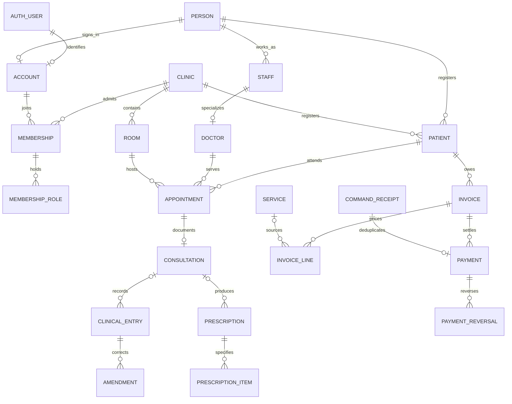

# Clinic database design

The connected visit requires 31 application tables. The [PostgreSQL reference definition](clinic-schema.sql) specifies every column, nullability, key, check and index. It is a design artifact for review. Sprint 2 migrations must be rehearsed on an isolated remote test target before deployment. Supabase owns `auth.users` and its credential and session tables. The shared Python service owns the private `clinic_app` schema.

## Read the visit from left to right

A visit uses an appointment, its assigned doctor and patient, then a consultation, optionally a prescription, and an invoice. Operational rows sit alongside this path. A command commits its receipt, audit and outbox in the same transaction. The following dictionary includes the supporting entities omitted from the overview. In the SQL, `REFERENCES` specifies the parent of each foreign key. Optional links permit standalone entries, prescriptions and invoice lines.

### Identity and permissions

| Table | Primary key | Other attributes (including foreign keys) |
| --- | --- | --- |
| `clinic` | id | name, timezone, currency, phone, email, address_line1, city, region, postal_code, country_code, active, version |
| `person` | id | given_name, family_name, birth_date, phone, email, address_line1, city, region, postal_code, country_code, version |
| `account` | id | person_id, username, enabled, auth_version, version |
| `patient` | clinic_id, id | person_id, patient_number, emergency_phone, emergency_email, archived_at, version |
| `staff` | clinic_id, id | person_id, staff_number, hired_on, active, version |
| `doctor` | clinic_id, id | staff_id, specialty, licence_number, active, version |
| `membership` | clinic_id, id | account_id, staff_id, patient_id, active, version |
| `staff_role` | code |  |
| `permission` | code |  |
| `membership_role` | clinic_id, membership_id, role |  |
| `role_grant` | clinic_id, role, permission, scope |  |
| `grant_field` | clinic_id, role, permission, scope, field_name |  |

### The visit

| Table | Primary key | Other attributes (including foreign keys) |
| --- | --- | --- |
| `opening_period` | clinic_id, weekday, opens_at | closes_at |
| `room` | clinic_id, id | number, kind, capacity, status, status_reason, version |
| `room_exception` | clinic_id, id | room_id, starts_at, ends_at, reason_code |
| `doctor_exception` | clinic_id, id | doctor_id, starts_at, ends_at, reason_code |
| `appointment` | clinic_id, id | patient_id, doctor_id, room_id, starts_at, ends_at, status, reason_summary, cancellation_reason, updated_at, version |
| `consultation` | clinic_id, id | appointment_id, note, created_at, updated_at, status, finalized_at, version |
| `clinical_entry` | clinic_id, id | consultation_id, standalone_patient_id, author_id, kind, content, recorded_at |
| `amendment` | clinic_id, id | entry_id, author_id, reason, replacement_content, recorded_at |
| `prescription` | clinic_id, id | consultation_id, standalone_patient_id, standalone_doctor_id, status, issued_at, cancel_reason, cancelled_at, version |
| `prescription_item` | clinic_id, prescription_id, position | medication_name, strength, form, dose, route, frequency, duration, instructions |
| `service` | clinic_id, id | code, description, price, currency, duration_minutes, active, version |

### Billing and operations

| Table | Primary key | Other attributes (including foreign keys) |
| --- | --- | --- |
| `invoice` | clinic_id, id | patient_id, currency, status, number, issued_at, due_on, void_reason, voided_at, version |
| `invoice_line` | clinic_id, id | invoice_id, position, description, quantity, unit_price, discount_amount, tax_rate, source_service_id, source_consultation_id |
| `invoice_counter` | clinic_id, year | last_value |
| `payment` | clinic_id, id | invoice_id, amount, method, received_at, received_by, idempotency_key, external_reference |
| `payment_reversal` | clinic_id, id | payment_id, amount, reason, reversed_at, reversed_by, idempotency_key |
| `command_receipt` | clinic_id, actor_id, command_key | operation, request_digest, result_type, result_id, result_version, committed_at |
| `audit_entry` | clinic_id, id | actor_id, action, resource_type, resource_id, outcome, occurred_at, correlation_id, reason_code |
| `outbox_event` | clinic_id, id | event_type, entity_id, entity_version, actor_id, occurred_at, correlation_id, delivered_at, attempts |

## Normalization and reconstruction

1. **First normal form.** Each role, field grant, opening period, prescription item and invoice line occupies one row. Contact details are atomic phone/email columns. An address is a value owned by its person or clinic. Multiple historical addresses or contact points would require child rows in a later increment.
2. **Second normal form.** A tenant aggregate is identified by the composite `(clinic_id, id)`. Every dependent tenant FK includes the clinic. The prescription item key includes its position. A role assignment uses the membership and role as its key. Identity attributes live once on the global person row. Lookups by a clinic user must join through a permitted profile.
3. **Third normal form.** Consultation resolves patient and doctor through its uniquely linked appointment. Linked entries and prescriptions resolve patient through that chain. Standalone rows carry their own subject. Amendments resolve patient through the original entry. Derive invoice totals, net paid, outstanding, overdue state, age and display name when reading. Reconstruct domain DTOs at the repository boundary.
4. **Facts fixed at issue time.** A billed description, unit price, discount and tax describe the individual sale. An issued prescription line records the medication wording actually prescribed. Subsequent catalog edits must preserve those facts. A receipt records a command outcome at commit time, and an audit row records an occurrence. Generic audit/resource IDs are historical references discriminated by type; they intentionally have no universal FK.
5. **Identity-provider boundary.** Account ID equals the verified Supabase subject. Authenticate with Supabase, then resolve the enabled account and current membership in PostgreSQL. Keep password hashes and refresh-token persistence with Auth. The original local-password `UserAccount` and `SessionRepository` contracts remain available for their existing callers. The hosted adapter projects `Principal` directly from verified subject and authorized membership. Never synthesize a password hash to hydrate a legacy object.
6. **Role and assignment.** Keep the approved permission matrix versioned and translate it to role/grant rows during migration. Derive doctor assignment through staff and doctor profiles, and verify that membership profile and account refer to the same person. Leave new grants empty until reviewed. The staff demo uses role grants for a cashier operation; there is no distinct CASHIER enum.

## Transaction invariants and deployment checks

| Operation | Enforce and demonstrate |
| --- | --- |
| Booking | In one transaction check clinic hours, resource exceptions, status and membership. Two partial GiST exclusions prevent overlaps on the same doctor or room. Intervals are half-open. Race two independent connections and verify one commit, adjacent bookings succeed, unrelated clinics do not conflict. |
| Clinical | Finalization checks the expected version and server-derived assignment. Append entries/amendments. Restrict UPDATE/DELETE of historical rows, and reject mismatched subject or appointment on reconstruction. Preserve item order and exercise standalone records. |
| Money | Lock the invoice before computing net paid. Validate exact decimal bounds before conversion to SQL types. Lock the original payment for reversals, in consistent invoice-then-payment order. Check consultation and invoice belong to the same patient before writing a sourced line. Validate duplicate service/visit pairs against the invoicing policy. Assign invoice numbers by atomic increment of the clinic/year counter. |
| Replay | Scope a command key to clinic and actor. Hash operation, route target, requested version and canonical body. Concurrent identical attempts yield one committed receipt and one payment. A changed hash is a conflict. Return receipt metadata only after reauthorizing the requesting actor. |
| Delivery | Dispatch committed outbox rows with bounded batches, retry and at-least-once semantics. Emit minimal invalidations and refetch via authorized endpoints. Verify send-after-commit, duplicate delivery and reconnect. |
| Operations | Split migration, runtime and outbox privileges. Keep the schema unexposed, revoke client grants and scope backend queries per clinic. Before any direct client policy is introduced, review RLS, enabled-account checks and field projections. Benchmark the indexed queries on synthetic representative data with EXPLAIN ANALYZE and a bounded page of at most 100. Measure p95 and pool waits before adding indexes. |

The SQL is a structural reference. Production migrations also need least-privilege role grants, append-only protections, approved policy data, seed fixtures and migration tests. Clinical narratives, token values and connection passwords stay out of command receipts, logs and events. Domain/application checks supplement SQL for aggregate state transitions and immutable snapshots. Extend the model at backlog selection for surgery, labs, inventory, procurement, finance and a patient portal. Their reviewed designs live in this directory.

## Expansion map for later increments

These logical relations describe where previously requested features attach. Their keys and relationships are design inputs for backlog refinement. The 31-table reference SQL covers the accepted connected visit. In the sketches below, each aggregate has a tenant-scoped key `(clinic_id, id)`. A named parent ID is a foreign key in the same clinic. Child rows with a position use `(clinic_id, parent_id, position)` as their key. Measures and money use Decimal and an explicit unit or document currency.

| Feature | Relations and identifying attributes | Relationship or derived result |
| --- | --- | --- |
| Stock | material(sku, name, unit, reorder_level, active); stock_lot(material_id, lot_number, expiry_date); stock_movement(material_id, lot_id?, movement_kind, signed_quantity, reason, actor_id, occurred_at) | One material has many lots and immutable movements. A receipt link identifies the source goods-receipt line. Compute on-hand by summing movements and low-stock by comparing with reorder level. |
| Suppliers and purchasing | supplier(code, name, contact, active); purchase_order(supplier_id, number, status, ordered_at, currency); purchase_order_line(order_id, position, material_id, ordered_quantity, agreed_unit_cost); goods_receipt(order_id, received_at, received_by); goods_receipt_line(receipt_id, position, order_line_id, lot_id?, received_quantity); supplier_invoice(supplier_id, supplier_document_number, issued_on, due_on, currency); supplier_invoice_line(invoice_id, position, receipt_line_id?, description, quantity, unit_cost); supplier_payment(invoice_id, amount, method, paid_at, actor_id) | Keep quantity received, supplier liability and payment as separate facts. Uniqueness is per supplier invoice number. Reconcile invoiced, received and outstanding with joins. |
| Finance and credits | expense_category(code, name); expense(category_id, incurred_on, amount, currency, description, actor_id); credit_note(invoice_id, amount, reason, issued_at); patient_credit(patient_id, received_at, amount, currency); payment_allocation(credit_id, invoice_id, amount, allocated_at) | Cash received, adjustments and allocations are independent entries. Derive expense totals, receivables and payables by reporting period. Pricing policy is application behavior. |
| Staffing and inpatient care | bed(room_id, number, active); admission(patient_id, bed_id, admitted_at, discharged_at?, agreed_daily_rate); staff_shift(staff_id, starts_at, ends_at); equipment(asset_code, name, status, next_maintenance_date?); availability_rule(resource_id, recurrence, timezone, effective_from, effective_until?) | Room/bed number is unique per room. Bed occupancy comes from admissions. Introduce a common reservable-resource identity for doctors, rooms and equipment before sharing reservation rules with surgery. |
| Procedures and surgery | procedure_type(code, name, service_id, duration_minutes); surgery(patient_id, procedure_id, lead_doctor_id, status); surgery_team_member(surgery_id, staff_id, role) with key (clinic,surgery,staff,role); resource_reservation(resource_id, starts_at, ends_at, status); surgery_reservation(surgery_id, reservation_id) | One surgery reserves several resources and has several staff members. Serialize active intervals across bookings and surgery through the same reservation source. |
| Care plans, allergy and attachments | allergy(patient_id, substance, reaction, severity, status, recorded_by, recorded_at); treatment_plan(patient_id, author_id, title, status, starts_on, ends_on?); treatment_goal(plan_id, position, description, state); attachment(patient_id, entry_id?, object_key, media_type, byte_size, checksum, scan_status, uploaded_by, uploaded_at) | Patient history is a projection of entries and corrections. Restrict attachment metadata and object access separately. The object store holds file bytes. |
| Laboratory | lab_test_type(code, name, result_kind, unit?, service_id); lab_order(patient_id, doctor_id, ordered_at, status); lab_order_item(order_id, position, test_type_id, instructions?); lab_result(order_item_id, numeric_value? or text_value?, unit?, reference_text?, entered_by, validated_by?, recorded_at); lab_result_amendment(result_id, author_id, reason, content, recorded_at) | Bind results to an ordered item. Use one value matching its type. Preserve the original and keep validation and later amendments attributable. |
| Patient portal | Reuse account, patient and membership. Add booking_request(patient_id, requested_slot, service_id?, state, decided_at?, appointment_id?) only if a human approval step is selected. | Scope patient reads to their own records. Reuse booking constraints and command receipts. Patient-specific access policies require separate review. |

The [clinical](clinical.md), [inventory](inventory.md), [facilities](facilities-scheduling.md) and [billing/procurement](billing-procurement.md) specifications carry the domain rules and deferred issue links.
